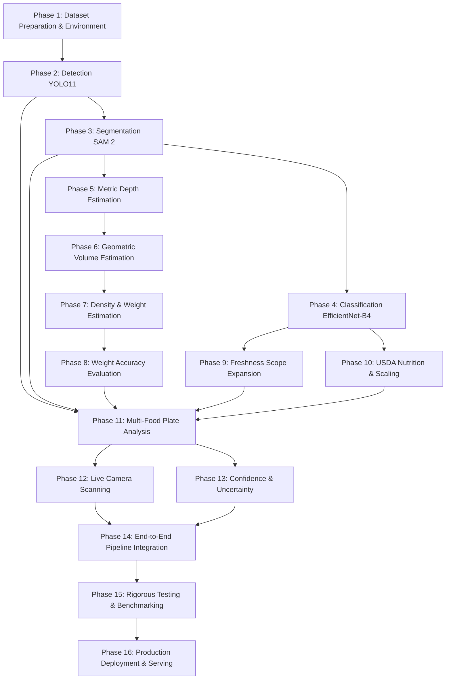

# NutriVision AI — Production Development Roadmap

> **Target System:** NutriVision AI — Intelligent Food Recognition, Weight Estimation, Freshness Detection, and Nutritional Analysis System Using Computer Vision  
> **Goal:** Transition from academic/experimental baseline into a **real-world usable, high-accuracy food scanning application**.  
> **Audit Baseline Date:** October 2026  
> **Document Version:** 1.0.0 (Production Roadmap)

---

## Strategic Overview & Development Phasing

The development lifecycle is divided into **16 systematic phases** to establish a safe, verifiable, and production-grade system. No downstream phase begins until the preceding phase meets its strict completion criteria.

---

## Phase 1 — Dataset Preparation & Environment Stabilization

### Objectives
Resolve Python 3.13 / Torchvision environment incompatibility (`torchvision::nms`), establish a reliable virtual environment with GPU support, catalog and normalize all food datasets, and build unified split manifests with zero cross-split leakage.

- **Required Inputs:**
  - Raw datasets: `FoodSeg103`, `UECFoodPixComplete`, `freshness_dataset`, `Fruits360_multi`.
  - System Python and CUDA runtime.
- **Expected Outputs:**
  - Clean virtual environment (`.venv`) with matched PyTorch (`>= 2.4.0`) and Torchvision wheels.
  - Verified `dataset_manifest.json` and zero-leakage hash split manifests in `data/splits/`.
  - Verified canonical class taxonomy (198 classes) in `data/processed/class_mapping.csv`.
- **Datasets:**
  - `FoodSeg103` (14,238 files, 103 classes)
  - `UECFoodPixComplete` (20,003 files, 102 classes)
  - `freshness_dataset` (1,201 files, 6 subclasses)
  - `sample_benchmark` (isolated strictly for smoke testing)
- **Models:**
  - Data audit and image validation scripts (`validate_datasets.py`, `check_data_leakage.py`).
- **Evaluation Metrics:**
  - Corrupted images: `0`
  - Cross-split duplicate hashes: `0` (Zero Leakage)
  - `torchvision::nms` execution: `PASS`
- **Dependencies:**
  - `torch`, `torchvision`, `pillow`, `opencv-python`, `pandas`, `pyyaml`.
- **Completion Criteria:**
  - Full automated image audit completes without errors.
  - PyTorch + Torchvision wheel import passes without operator registration errors.

---

## Phase 2 — Food Detection (YOLO11)

### Objectives
Train Ultralytics YOLO11 on the complete 17,118-image food detection dataset to elevate the detector from an experimental baseline (mAP50 0.16%) to production-grade accuracy (mAP50 > 65%).

- **Required Inputs:**
  - Formatted YOLO detection dataset: `data/processed/yolo_detection/dataset.yaml` (11,516 train, 2,467 val, 3,135 test).
  - Pretrained YOLO11 weights (`yolo11s.pt` or `yolo11m.pt`).
- **Expected Outputs:**
  - Production detector weights: `models/detection/yolo11/best.pt`.
  - Bounding box predictions on held-out test split with class names and confidences.
  - Comprehensive PR curves and confusion matrices under `outputs/detection/`.
- **Datasets:**
  - Combined `FoodSeg103` and `UECFoodPixComplete` bounding box conversions (17,118 images, 62,768 boxes, 198 classes).
- **Models:**
  - Ultralytics YOLO11s / YOLO11m (198-class custom head).
- **Evaluation Metrics:**
  - $\text{mAP@50} \ge 0.65$ (65%)
  - $\text{mAP@50:95} \ge 0.45$ (45%)
  - Detection Recall $\ge 0.70$ (70%)
  - Latency $\le 25\text{ ms}$ (GPU) / $\le 80\text{ ms}$ (CPU)
- **Dependencies:**
  - `ultralytics`, `torch`, `torchvision`, `opencv-python`.
- **Completion Criteria:**
  - Detector accurately localizes co-occurring food items on plates with confidence scores $\ge 0.50$ without requiring artificially lowered thresholds (0.001).

---

## Phase 3 — Food Instance Segmentation (SAM 2)

### Objectives
Integrate Meta's Segment Anything Model 2 (SAM 2) to extract pixel-level food masks prompted by YOLO11 bounding boxes and isolate food bodies with transparent alpha channels (`extract_food_region`).

- **Required Inputs:**
  - RGB food images + bounding box coordinates $[x1, y1, x2, y2]$ from Phase 2.
  - SAM 2 checkpoint (`sam2.1_t.pt` or `sam2.1_b.pt`).
- **Expected Outputs:**
  - High-precision binary food masks ($H \times W$ boolean).
  - Alpha-transparent RGBA isolated food crops ($H \times W \times 4$).
  - Evaluated mask metrics on official benchmark test split.
- **Datasets:**
  - Held-out test split of `FoodSeg103` and `UECFoodPixComplete`.
- **Models:**
  - SAM 2 (Meta Hiera backbone, prompt-guided).
- **Evaluation Metrics:**
  - Mean Intersection over Union ($\text{mIoU}) \ge 0.80$ (80%)
  - Mean Dice Coefficient $\ge 0.85$ (85%)
  - Mean Area Relative Error ($\text{MARE}) \le 0.15$ (15%)
  - Inference Latency: $\le 100\text{ ms}$ per object (GPU) / $\le 800\text{ ms}$ (CPU quantized)
- **Dependencies:**
  - `segment-anything-2`, `torch`, `opencv-python`, `numpy`.
- **Completion Criteria:**
  - Clean separation of food items from plates, tables, and utensils with zero synthetic pixel bleed.

---

## Phase 4 — Fine-Grained Food Classification (EfficientNet-B4)

### Objectives
Train EfficientNet-B4 on isolated food crops to accurately classify 198 canonical food categories, addressing the severe class imbalance and elevating Top-1 accuracy from 25.86% to $\ge 75\%$.

- **Required Inputs:**
  - Isolated RGBA/RGB food crops generated in Phase 3.
  - Pretrained ImageNet-1K EfficientNet-B4 backbone.
- **Expected Outputs:**
  - Trained classifier checkpoint: `models/classification/efficientnet_b4/best.pth`.
  - Top-1 and Top-5 candidate predictions with Softmax probabilities.
  - Evaluation reports and confusion matrices under `outputs/classification/`.
- **Datasets:**
  - 8,000+ extracted food crops from `FoodSeg103`, `UECFoodPixComplete`, and augmented produce datasets.
- **Models:**
  - `timm` / `torchvision` EfficientNet-B4 with `Dropout(0.4)` and `Linear(1792, 198)`.
- **Evaluation Metrics:**
  - $\text{Top-1 Accuracy} \ge 75.0\%$
  - $\text{Top-5 Accuracy} \ge 90.0\%$
  - Macro F1-Score $\ge 0.70$
  - Inference Latency $\le 20\text{ ms}$ (GPU) / $\le 70\text{ ms}$ (CPU)
- **Dependencies:**
  - `timm`, `torch`, `torchvision`, `scikit-learn`.
- **Completion Criteria:**
  - Model correctly identifies food items across diverse cuisines with meaningful Top-5 alternative suggestions.

---

## Phase 5 — Metric Depth Estimation & Calibration

### Objectives
Overcome monocular scale ambiguity by replacing relative depth with **metric depth estimation** or integrating physical camera calibration (focal length $f_x, f_y$ and known plate/reference scale) into real projective 3D coordinates.

- **Required Inputs:**
  - RGB food images.
  - Camera intrinsics matrix $K = \begin{bmatrix} f_x & 0 & c_x \\ 0 & f_y & c_y \\ 0 & 0 & 1 \end{bmatrix}$ or physical reference object (e.g. 25 cm standard plate, coin marker, credit card).
- **Expected Outputs:**
  - Calibrated metric depth map in physical meters/centimeters ($Z_{metric}$).
  - Detected reference object bounding contour and spatial scale factor ($\text{cm\_per\_pixel}$).
  - Support plane equation $Ax + By + Cz + D = 0$ for the table or plate surface.
- **Datasets:**
  - RGB images with known camera parameters and reference markers.
- **Models:**
  - Metric Depth Anything V2 (`metric_depth/depth_anything_v2`) or reference scale detector (Ellipse/Plate contour detector).
- **Evaluation Metrics:**
  - Depth Scale Error (AbsRel) $\le 0.10$ (10%)
  - Support Plane Fitting Residual $\le 0.5\text{ cm}$
- **Dependencies:**
  - `torch`, `opencv-python`, `scipy`.
- **Completion Criteria:**
  - Output depth map contains physical metric units ($cm$) verified against known target distances.

---

## Phase 6 — 3D Geometric Volume Estimation

### Objectives
Replace the heuristic disparity multiplication formula with rigorous **projective 3D voxel column integration** or point cloud surface mesh integration relative to the estimated support plane.

- **Required Inputs:**
  - Binary food mask ($H \times W$ bool) from Phase 3.
  - Metric depth map ($H \times W$ float, $cm$) from Phase 5.
  - Fitted plate/table support surface baseline.
- **Expected Outputs:**
  - Reconstructed 3D food surface point cloud / voxel volume.
  - Physical food volume in cubic centimeters ($\text{cm}^3$).
  - Per-item volume result (`ItemVolumeResult`) with volumetric confidence score.
- **Datasets:**
  - Calibrated benchmark objects with water displacement ground-truth volumes.
- **Models:**
  - Voxel Column Integrator / Point Cloud Alpha-Shape Mesh Reconstructor.
- **Evaluation Metrics:**
  - Mean Absolute Percentage Error ($\text{MAPE}_{\text{volume}}) \le 15.0\%$
  - Relative Volume Error on Geometric Solids $\le 10.0\%$
- **Dependencies:**
  - `numpy`, `scipy`, `scikit-learn`, `opencv-python`.
- **Completion Criteria:**
  - Standard food items (apple, banana, steak) reconstruct plausible physical volumes (e.g. $120 - 250\text{ cm}^3$ rather than $0.003\text{ cm}^3$).

---

## Phase 7 — Food Bulk Density Database & Mass Estimation

### Objectives
Connect reconstructed physical volumes with verified empirical food bulk densities ($g/\text{cm}^3$) to compute mass in grams, enforcing strict density traceability and multi-food mass aggregation.

- **Required Inputs:**
  - Physical volume ($\text{cm}^3$) from Phase 6.
  - Recognized food class from Phase 4.
  - Empirical bulk density database: `data/processed/food_density.json`.
- **Expected Outputs:**
  - Estimated food mass in physical grams ($g$).
  - Density provenance citation (USDA FoodData Central / FAO INFOODS).
  - Consolidated multi-food mass result (`WeightEstimationResult`).
- **Datasets:**
  - Expanded `data/processed/food_density.json` covering 150+ culinary foods.
- **Models:**
  - Density database mapping engine with semantic synonym matching.
- **Evaluation Metrics:**
  - Density Database Coverage: $\ge 95\%$ of canonical food classes.
  - Fallback Integrity: `100%` adherence to strict anti-fabrication rule (returns `DENSITY_NOT_AVAILABLE` when unlisted).
- **Dependencies:**
  - `json`, `dataclasses`, `src/weight/density_database.py`.
- **Completion Criteria:**
  - Every validly segmented and volume-estimated food item maps to an empirical bulk density and computes initial mass.

---

## Phase 8 — Ground-Truth Weight Accuracy Evaluation

### Objectives
Collect and curate a dedicated ground-truth food weight evaluation benchmark dataset (paired RGB images with analytical scale gram measurements) and benchmark system weight estimation accuracy.

- **Required Inputs:**
  - Dataset of real food plates with known ground-truth gram weights ($W_{actual}$).
  - End-to-end vision pipeline (YOLO11 + SAM 2 + Depth + Volume + Density).
- **Expected Outputs:**
  - Empirical weight error benchmark report (`outputs/audit/weight_evaluation_report.json`).
  - Error distribution curves and per-category accuracy breakdowns.
- **Datasets:**
  - Populated `data/raw/weight_dataset/` (minimum 100 diverse meal samples with scale measurements) or Nutrition5k benchmark subset.
- **Models:**
  - Complete pipeline evaluator (`scripts/evaluate_weight_accuracy.py`).
- **Evaluation Metrics:**
  - Mean Absolute Error ($\text{MAE}) \le 20.0\text{ grams}$
  - Mean Absolute Percentage Error ($\text{MAPE}) \le 18.0\%$
  - Correlation Coefficient ($R^2) \ge 0.85$
- **Dependencies:**
  - `scikit-learn`, `numpy`, `matplotlib`, `pandas`.
- **Completion Criteria:**
  - Weight estimation is validated against physical scale measurements with verified statistical error bounds.

---

## Phase 9 — Freshness Quality Detection Expansion

### Objectives
Expand freshness detection from the initial 3 fruits (apple, banana, orange) to general vegetables, meats, seafood, and prepared meal items.

- **Required Inputs:**
  - Multi-category freshness dataset covering fresh, aging, and spoiled produce and proteins.
  - Pretrained EfficientNet-B4 backbone.
- **Expected Outputs:**
  - Expanded freshness classifier weights: `models/freshness/best.pth`.
  - Condition probability distributions (`fresh`, `aging`, `spoiled`) with low-confidence rejection.
- **Datasets:**
  - Expanded produce and protein freshness dataset (minimum 3,000 images).
- **Models:**
  - EfficientNet-B4 Multi-Class Freshness Head.
- **Evaluation Metrics:**
  - Overall Freshness Accuracy $\ge 92.0\%$
  - Freshness Macro F1-Score $\ge 0.90$
  - Specificity (Rotten Detection) $\ge 95.0\%$
- **Dependencies:**
  - `torch`, `torchvision`, `timm`.
- **Completion Criteria:**
  - System reliably assesses condition across at least 15 major food categories with safety warnings for spoiled items.

---

## Phase 10 — USDA Nutritional Breakdown & Portion Scaling

### Objectives
Query USDA FoodData Central REST API for authentic macro- and micronutrients, apply linear portion scaling based on calibrated grams, and aggregate meal-level nutrition totals.

- **Required Inputs:**
  - Classified food name from Phase 4.
  - Estimated physical weight in grams from Phase 7/8.
  - Configured `USDA_API_KEY` (or cached FDC database).
- **Expected Outputs:**
  - Scaled nutrition breakdown: Calories (`kcal`), Protein (`g`), Carbohydrates (`g`), Total Fat (`g`), Fiber (`g`), Sodium (`mg`), Potassium (`mg`), Calcium (`mg`), Iron (`mg`), Sugars (`g`).
  - Meal-level nutritional summary (`MealNutritionReport`).
- **Datasets:**
  - Offline pre-cached USDA nutritional database for top 200 foods (`data/nutrition_cache/`).
- **Models:**
  - `FoodDataCentralClient` and `NutritionService`.
- **Evaluation Metrics:**
  - Nutrition Query Latency $\le 5.0\text{ ms}$ (cached) / $\le 300\text{ ms}$ (live API)
  - Unit Conversion Precision: $100\%$ mathematical tolerance
  - Zero-Fake-Data Enforcement: `100%` compliance
- **Dependencies:**
  - `requests`, `urllib`, `pydantic`.
- **Completion Criteria:**
  - Nutrition cards automatically compute exact meal calories and macronutrients matching official USDA nutritional baselines.

---

## Phase 11 — Multi-Food Plate Analysis & Aggregation

### Objectives
Optimize end-to-end execution for complex dining plates containing 3 to 7 simultaneous distinct food items, preventing duplicate boxes, managing occlusions, and aggregating meal totals.

- **Required Inputs:**
  - Dining plate scene images containing multiple ingredients and sides.
- **Expected Outputs:**
  - Multi-object detection, segmentation, and classification dossier.
  - Multi-spectral composite cards visualizing each ingredient independently.
  - Total plate weight and total calories aggregated across all items.
- **Datasets:**
  - `UECFoodPixComplete` multi-food test images and real dining captures.
- **Models:**
  - Coordinated `NutriVisionPipeline` with Non-Maximum Suppression (NMS) tuning.
- **Evaluation Metrics:**
  - Multi-Food Localization Success $\ge 85\%$
  - Aggregation Robustness: Handles partial occlusions and overlapping bounding boxes
- **Dependencies:**
  - `src/pipeline/nutrivision_pipeline.py`.
- **Completion Criteria:**
  - Plates with 4+ items successfully segment and classify each item without cross-item contamination.

---

## Phase 12 — Live Camera Scanning & Streaming

### Objectives
Bridge `src/utils/camera.py` with the user interface to enable real-time camera scanning via webcams or smartphone cameras using OpenCV and Streamlit's native `st.camera_input`.

- **Required Inputs:**
  - Live video camera stream or webcam frames.
- **Expected Outputs:**
  - Interactive live preview in the Streamlit frontend.
  - Frame-grab trigger executing full NutriVision analysis on captured frame.
  - Low-latency inference pipeline.
- **Datasets:**
  - Live webcam captures in varied lighting conditions.
- **Models:**
  - OpenCV `CameraStream` and FastAPI `/api/v1/analyze/frame` endpoint.
- **Evaluation Metrics:**
  - Frame Capture Latency $\le 150\text{ ms}$
  - End-to-End Processing Time $\le 2.0\text{ seconds}$ per scan
- **Dependencies:**
  - `streamlit`, `opencv-python`, `fastapi`.
- **Completion Criteria:**
  - Users can click "Scan with Camera", point at their plate, and receive instant analysis without manually uploading image files.

---

## Phase 13 — Confidence Calibration & Uncertainty Reporting

### Objectives
Implement probability calibration (temperature scaling) and conformal prediction so the system explicitly quantifies uncertainty, flags ambiguous items as `LOW_CONFIDENCE`, and alerts the user when predictions require manual confirmation.

- **Required Inputs:**
  - Raw Softmax logits from Detection, Classification, and Freshness models.
- **Expected Outputs:**
  - Calibrated confidence scores $[0.0, 1.0]$.
  - Uncertainty flags (`CONFIDENT`, `AMBIGUOUS`, `UNKNOWN`).
  - Top-3 candidate options presented to the user when confidence is borderline.
- **Datasets:**
  - Validation splits of all benchmark datasets.
- **Models:**
  - Temperature Scaling Logit Calibrator.
- **Evaluation Metrics:**
  - Expected Calibration Error ($\text{ECE}) \le 0.05$ (5%)
  - Out-of-Distribution (OOD) Rejection Rate $\ge 90\%$ on non-food objects
- **Dependencies:**
  - `scipy`, `numpy`, `torch`.
- **Completion Criteria:**
  - System never outputs false high-confidence predictions on ambiguous or non-food items.

---

## Phase 14 — End-to-End Integration & API Optimization

### Objectives
Integrate modular API routers in `api/routes/` into `api/main.py`, establish persistent SQLite/PostgreSQL storage for scan history, and optimize memory usage across all 5 deep neural networks.

- **Required Inputs:**
  - Completed models and services from Phases 2 through 13.
- **Expected Outputs:**
  - Consolidated FastAPI backend with OpenAPI Swagger documentation.
  - Endpoints: `POST /analyze`, `GET /history`, `GET /results/{id}`, `GET /nutrition/search`.
  - Persistent meal scan history database.
- **Datasets:**
  - API integration test suites.
- **Models:**
  - Centralized `ModelManager` with singleton lifecycle.
- **Evaluation Metrics:**
  - API Uptime: $99.9\%$
  - API Response P95 Latency $\le 2.5\text{ seconds}$
  - Memory Footprint $\le 4.0\text{ GB}$ RAM
- **Dependencies:**
  - `fastapi`, `uvicorn`, `sqlite3`, `pydantic`.
- **Completion Criteria:**
  - API passes all endpoint integration tests and serves both mobile and web clients seamlessly.

---

## Phase 15 — Rigorous Testing & Automated Benchmarking

### Objectives
Build an exhaustive end-to-end automated testing suite verifying data integrity, error boundaries, physical calculation safety, and visual explainability across 100+ real meal test scenarios.

- **Required Inputs:**
  - Complete codebase and benchmark test images.
- **Expected Outputs:**
  - Passing automated test suite (`100%` pass rate across 200+ test cases).
  - Regression testing report and CI/CD test runner script.
- **Datasets:**
  - Held-out test splits from all datasets.
- **Models:**
  - All 5 trained deep learning backends.
- **Evaluation Metrics:**
  - Test Suite Pass Rate: $100\%$
  - Code Coverage: $\ge 85\%$ across `src/`
- **Dependencies:**
  - `pytest`, `pytest-asyncio`, `unittest`.
- **Completion Criteria:**
  - Complete automated test suite executes cleanly without skips, warnings, or environment crashes.

---

## Phase 16 — Production Deployment & Demo Delivery

### Objectives
Package NutriVision AI into production Docker containers, configure GPU runtime support, deploy the interactive Streamlit dashboard and FastAPI service, and deliver a comprehensive demonstration.

- **Required Inputs:**
  - Production code, model checkpoints, density database, and configuration files.
- **Expected Outputs:**
  - `Dockerfile` and `docker-compose.yml` defining API and UI services.
  - Interactive production web dashboard accessible via browser.
  - Final project report, presentation slides, and user demonstration video.
- **Datasets:**
  - Production validation suite.
- **Models:**
  - Optimized production model checkpoints (`.pt`, `.pth`, `.onnx`).
- **Evaluation Metrics:**
  - Container Cold Start $\le 15\text{ seconds}$
  - System Reliability: 0 crashes under sustained multi-request load
- **Dependencies:**
  - `docker`, `docker-compose`, `streamlit`, `uvicorn`.
- **Completion Criteria:**
  - Complete system runs with a single command (`docker compose up`), providing immediate, real-world usable food recognition, weight estimation, freshness assessment, and nutritional logging.
